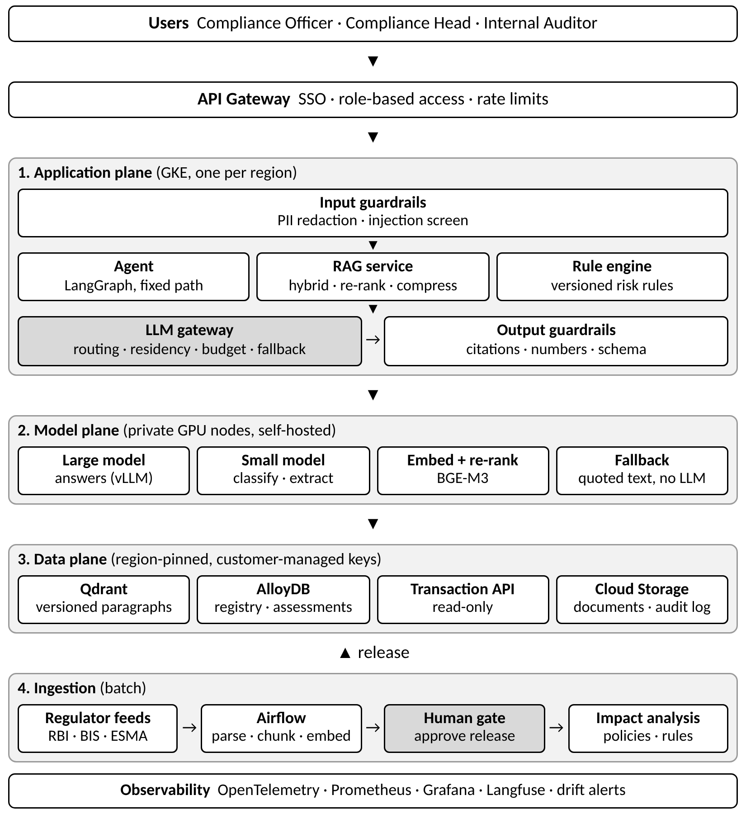
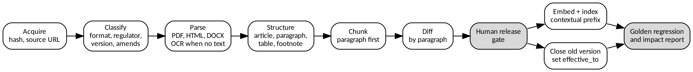
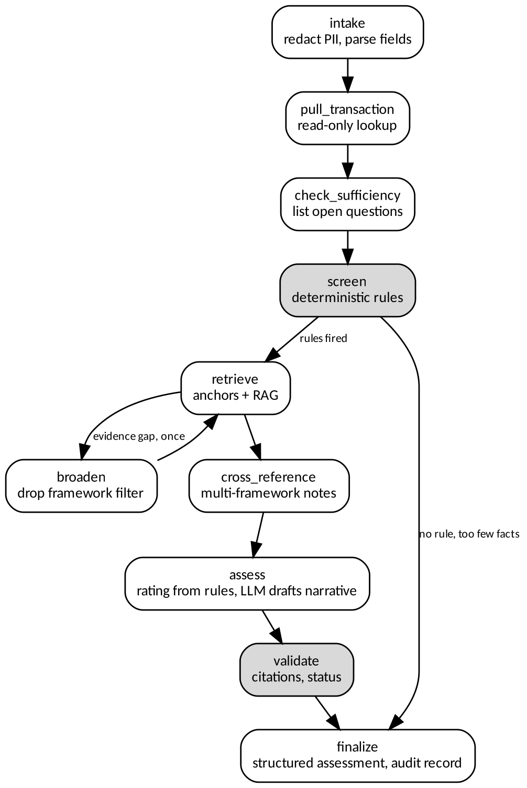
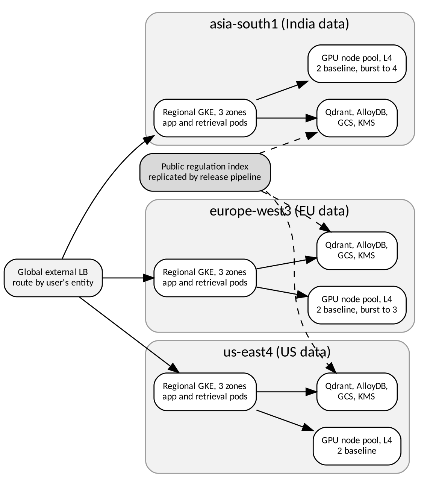

# FinServ Global Regulatory Compliance Assistant

**Solution Architecture Document**  
Dr. Ramkumar Gurusamy, AI Architect technical assignment, November 2026.

## 1. Summary

**The problem.** FinServ Global has 40 compliance officers. They spend more than 60% of their time searching regulatory PDFs and preparing evidence. More than 200 new circulars and amendments arrive each year across Basel III, MiFID II and RBI directions. One cross-border trade can fall under several frameworks, and regulators expect a documented reason for every decision.

**The approach.** Compliance is a traceability problem first and a language problem second. The design follows five rules:

1. **Rules decide, the LLM explains.** Risk ratings come from versioned rules that people can review. The LLM writes the explanation but cannot change a rating.
2. **Regulation is versioned by paragraph and date.** Any answer can be reproduced as of the day it was given.
3. **Every answer is checked before it is shown.** If a citation is invalid or a number is not in the source, the system retries once, then shows the quoted source text instead.
4. **Data residency is enforced in code.** The LLM gateway checks where the data may go before every call. If no model is allowed, the call is blocked.
5. **Failures are visible.** If the models are down, users get quoted sources marked as degraded. They never get an answer without citations.

The prototype is a working slice of this design. Section 10 lists what is built and tested and what is design only.

## 2. Requirements

| Area | Requirement | Target |
|---|---|---|
| Users | Officers, Compliance Head, Internal Auditor | Single sign-on with role-based views, in three regions |
| Load | 500 concurrent users, 10,000 queries a day | Peak of about 6.7 requests a second (see 8.3) |
| Q&A speed | Fast, cited answers | Full answer under 8 s (p95), first words under 1.5 s |
| Screening speed | Interactive | Under 15 s (p95) |
| Availability | Business critical, but not in the payment path | 99.9% per region; lose at most 15 min of data; recover within 1 hour |
| Evidence | Every decision must be traceable | 100% of AI-assisted outputs in a tamper-evident log |
| Freshness | 200+ changes a year | New regulation reviewed and live within 1 business day |
| Quality | No unsupported regulatory claims | Faithfulness at least 0.85; 100% of unanswerable questions refused |

**To confirm in discovery:** legal entity structure, any regulator conditions on cloud outsourcing, retention periods, the system of record for transactions, and which US rules are in scope. The assignment names Basel III, MiFID II and RBI, so US rules are an extension, not part of the current corpus.

## 3. Architecture overview

The system has four planes. Each can change without affecting the others.

| Plane | What it does | Why it is separate |
|---|---|---|
| Application | APIs, agent, rules, guardrails | No stored state, runs on CPU, released often |
| Model | Text generation, embeddings, re-ranking | Runs on GPUs, which cost and scale differently; models change on their own schedule |
| Data | Vectors, keyword index, registry, audit log | Pinned to one region, with the strictest access controls |
| Ingestion | Collect, parse, version and release regulation | Batch work with a human approval step, not on the query path |

**Why one LLM gateway?** Every model call goes through it. That gives one place to enforce residency, budgets and fallback, to count tokens, and to swap models without changing application code. The prototype's `ModelRouter` is a working version of the gateway.

## 4. RAG pipeline

### 4.1 Ingestion

| Format | Tool | How it is handled |
|---|---|---|
| Digital PDF | Docling (open source); PyPDF in the prototype | Keeps layout, headings and tables |
| Scanned PDF | Tesseract; Document AI as a paid option | Low text yield sends it to OCR, with quality sampling |
| HTML circulars | BeautifulSoup with one extractor per site | RBI and ESMA pages each have their own template |
| DOCX | python-docx through Docling | Tracked changes are flattened and logged |

**Metadata matters as much as text.** Each chunk stores the regulator, framework, jurisdiction, document reference, version, effective dates, paragraph reference, source URL, content hash and residency class. Citations and the audit log depend on these fields. A document with missing or invalid metadata is held back, not indexed with defaults.

**Watching for changes.** Scheduled jobs check regulator feeds and pages. A new or changed document opens a review task, and nothing goes live until a compliance reviewer releases it. This can add up to one business day. That is deliberate: a wrong regulation served quickly is worse than a correct one served a day later.

### 4.2 Chunking

| Option | Benefit | Problem | Decision |
|---|---|---|---|
| Fixed 512 tokens | Simple | Cuts clauses and breaks citations | Rejected |
| Recursive character split | Better boundaries | Does not know paragraph numbers | Rejected |
| Semantic split | Follows topics | Changes between runs and is hard to cite | Rejected |
| **Paragraph first, sentence windows if too long** | The chunk is the unit a regulator cites | Paragraph lengths vary | **Selected** |

**Rules:**

- One numbered paragraph is one chunk: up to 220 tokens in the prototype, 350 in production.
- A longer paragraph is split at sentence boundaries with about 15% overlap. Every piece keeps the same paragraph reference.
- Definitions, tables and footnotes stay with the paragraph they belong to. Tables are also stored as rows, because the answer is often a percentage in a table.
- Each chunk is embedded with a short prefix (framework, paragraph reference, heading), so a clause on its own still shows which regulation it comes from.

Overlap is kept small on purpose. Regulatory paragraphs are written to stand alone, and large overlap would fill the results with near-duplicates, pushing out other frameworks that a cross-regulation question needs.

### 4.3 Embedding model

| Model | Licence | Size | Strength | Weakness | Use |
|---|---|---|---|---|---|
| **BGE-M3** | MIT | 1024 | Dense and sparse output, long inputs, EU languages | Heavier than small models | **Production** |
| BGE-small-en-v1.5 | MIT | 384 | Fast on CPU | English only, less precise | Laptop |
| WordLlama L2 | MIT | 256 | Installed with pip, no download | Lower quality | Offline tests |
| Vertex AI embeddings | Proprietary | Up to 3072 | Managed, high quality | Vendor lock-in, cost per token | Not the default |

Self-hosted embeddings also keep query text, which can include client details, inside the region. A finance-specific fine-tune is possible later, but only if evaluation shows it helps, because it means re-embedding the whole corpus.

### 4.4 Vector database

**Qdrant**, self-hosted in each region. It has strong metadata filtering, built-in sparse vectors and tenant isolation. pgvector was the closest alternative. See ADR-001.

### 4.5 Retrieval steps

1. **Understand the query.** A small model labels the intent and framework. A glossary expands terms, for example `CDD` to `customer due diligence`. Expansions are used to find candidates, not to score them, because scoring on them ranked all KYC chunks equally.
2. **Filter.** Date (`as_of`), framework, jurisdiction and user permissions are applied before search.
3. **Hybrid search.** Dense search and BM25 keyword search each return 30 candidates. Keyword search is needed because regulators cite exact tokens such as `RBC20.1`, `Article 25(3)` and `4.5%`.
4. **Merge.** Reciprocal Rank Fusion (RRF) combines the two lists by rank, so scores need no calibration.
5. **Re-rank.** A cross-encoder re-scores the top 20 and keeps 6. Production uses `bge-reranker-v2-m3`. This step stays only while tests show it improves results (see 8.5).
6. **Compress.** Only the most relevant original sentences are kept. Compression selects sentences; it never rewrites legal text.
7. **Refuse when unsure.** If the evidence is weaker than a set threshold, the system says it cannot answer.

### 4.6 Updates and versioning

- **Nothing is deleted.** Each chunk has `effective_from` and `effective_to` dates. A new version closes the old chunk.
- **Partial amendments stay partial.** A circular that changes paragraph 50 closes only paragraph 50. The rest of the master direction stays live.
- **IDs are stable.** `chunk_id = hash(doc_id, version, paragraph, ordinal)`, so running ingestion twice gives the same result.
- **Point-in-time questions.** Filtering on effective dates answers "what applied on 14 March?", so an auditor can replay an old decision against the rules in force at the time.
- **Safe re-indexing.** A new embedding model builds a new collection, must pass the test set, and then an alias switches over. The old collection stays for rollback.

**When sources conflict**, both are shown. For example, an RBI rule and the Basel standard are both cited, and the stricter one is flagged for an officer.

## 5. LLM orchestration

### 5.1 Model selection

Open models change quickly, so the design fixes **how a model is chosen**. The models below are the current shortlist. The final choice needs a benchmark on FinServ's own test set.

| Tier | Task | Shortlist | Hosting | Why |
|---|---|---|---|---|
| Fast | Classify, extract, route | Gemma 4 small variants, Granite 3.3 2B | vLLM or CPU | Low cost, permissive licences |
| Main | Cited answers, narratives | Gemma 4 31B or Qwen 3.6 35B | vLLM on one L4 GPU | Apache 2.0; reported to fit 24 GB when quantised |
| Escalation | Reasoning across frameworks | Mistral Small 4 (needs at least 48 GB, as reported) | vLLM on a larger GPU | Only if tests show the main tier falls short |
| Optional, **proprietary** | Managed fallback in region | Gemini on Vertex AI, regional endpoint | Google-managed | Only after legal review; the open fallback stays the default |

**Selection order:** licence allowed, can run in region, faithfulness on the test set, p95 latency under load, then cost.

**Replacing a model.** Weights and tokenisers are pinned by digest in a private registry. A new model first runs in shadow, then takes 5%, 25% and 100% of traffic. If faithfulness drops 0.03 below the current model, or refusal accuracy drops at all, it rolls back automatically.

### 5.2 Routing

| Request | Route |
|---|---|
| Intent labelling, field extraction | Fast tier |
| Factual question on one framework | Main tier |
| Several frameworks, or a screening narrative | Main tier; escalation tier if validation fails |
| Provider failure, circuit open or residency denied | Next allowed provider; finally the extractive fallback |
| Daily budget used up | Paid external tiers stop; self-hosted tiers continue |

Every call goes through four checks in order: residency, budget, circuit breaker, then the call itself. The prototype implements and tests all four.

### 5.3 Prompts

Prompts are kept in version control (`config/prompts.yaml`), and each answer records the prompt version used. A prompt change must pass the same evaluation as a code change.

| Part | Content |
|---|---|
| System | Role, answer only from sources, citation format, copy numbers exactly, refusal phrase, no legal rulings |
| Examples | One cited answer and one refusal, so a small model learns that refusing is allowed |
| Reasoning | Hidden steps: find sources, check versions, note conflicts, write supported sentences. The steps are not shown, so the output stays clean and unsupported reasoning does not reach users |
| Task | Numbered sources with paragraph and version |
| Retry | States exactly which check failed |

**Prompt injection.** Retrieved text is marked as reference data, and the model is told to ignore any instructions inside it. Inputs are screened for known attack patterns. The main protection is that the agent's tools are read-only, so a successful injection has nothing to act on.

### 5.4 Guardrails

| Stage | Check | Method | If it fails | In prototype |
|---|---|---|---|---|
| Input | PII removal | Regex now; Presidio or GLiNER in production | Redact and count | Yes (regex) |
| Input | Injection screen | Pattern match | Refuse and log | Yes |
| Retrieval | Weak evidence | Evidence threshold | Refuse | Yes |
| Retrieval | Permissions | Metadata filter | Exclude | Design |
| Output | Valid citations | Each label must match a retrieved chunk | Retry, then fallback | Yes |
| Output | Correct numbers | Every number must appear in the cited source | Retry, then fallback | Yes |
| Output | Hallucination | Sentence-level entailment model | Retry, then fallback | Design; simple rule-based check in prototype |
| Output | Structure | Pydantic schema validation | Reject | Yes |
| Decision | Human review | Critical or incomplete cases go to an officer | Queue | Yes (status) |

ADR-003 explains why these checks are built into the application instead of relying only on a guardrail framework.

## 6. Agent design

### 6.1 Framework

**LangGraph**, used as a fixed state machine, not a free-running agent. It gives typed state, conditional steps, checkpoints and a trace that can be replayed. CrewAI's role-based conversations are harder to audit, and plain code would mean rebuilding checkpoints and tracing. See ADR-002.

### 6.2 Workflow

The key choice is **what the LLM is not allowed to do**. It does not choose tools, set a rating or decide which regulation applies. Those steps are fixed code. A free-running agent would be more flexible, but its path could change from run to run, which does not suit a decision that must be audited. Retrieval supplies evidence for the rules, and the LLM only writes the explanation, which must pass validation.

### 6.3 Tools

| Tool | Input | Output | Changes data? | If it fails |
|---|---|---|---|---|
| `query_regulations` | Query, frameworks, as_of date | Ranked, versioned chunks | No | Retry once with a broader search, then human review |
| `get_paragraph` | Paragraph reference | Current paragraph | No | Flag an evidence gap |
| `pull_transaction` | Transaction ID | Transaction record | No (read-only) | Record the error, human review |
| `screen_rules` | Transaction | Rules triggered | No | Schema error stops the run |
| `generate_narrative` | Findings, sources | Cited summary | No | Use template text |
| `write_audit` | Event | Audit ID | Append only | Run stops (fails closed) in production |

### 6.4 State and errors

The agent's state holds: raw input, cleaned transaction, trace, triggered rules, evidence, gaps, findings, questions, status and rating. Production saves checkpoints to AlloyDB, so a run continues after a restart. The prototype keeps checkpoints in memory.

| Situation | What happens |
|---|---|
| Missing facts | Unknown values stay empty and never lower the risk. The system gives a provisional rating and asks specific questions |
| Too little information | Status `INSUFFICIENT_INFO`, rating `UNDETERMINED`; no guessing |
| Search fails | One broader retry, then `HUMAN_REVIEW`; the rule-based rating stands |
| Transaction not found | Recorded; `HUMAN_REVIEW` |
| LLM fails | Template narrative is used; rating and citations are unaffected |
| Several frameworks apply | Each obligation is listed separately, and the stricter one is flagged |

### 6.5 Change impact and reports

- **New regulation.** Changed paragraphs are matched against the policy register and the rules that cite them. Direct links are reported as affected. Similar-sounding items are only listed as "possible" for review.
- **Compliance reports.** Reports group assessments by risk, framework and finding. Each line links to the audit log by assessment ID. All figures come from stored data, not from a model.

## 7. Security and data residency

### 7.1 Data classes

| Class | Examples | Where it can go |
|---|---|---|
| Public regulation | Basel text, published circulars | Any approved region |
| Internal | Policies, reports, prompts | The entity's own region |
| Confidential | Transactions, client details | The entity's own region, self-hosted models only |
| Restricted | ID documents, account numbers | Removed before any model call |

Regulatory text is public, so the sensitive part of a prompt is usually the transaction. Even so, RBI-tagged text is treated as India-only by default, because the same prompt often carries client details, and because that is the safe reading of the client's requirement.

### 7.2 Stopping data leaks to external providers

1. **Self-hosted by default.** All models run in the same region as the data, so no core flow needs an external LLM.
2. **Network.** GKE nodes have no public IP. VPC Service Controls and a default-deny egress policy block model pods from the internet.
3. **Code.** The gateway refuses any provider not cleared for the data's residency class. If none is cleared, the call is blocked. Tests confirm the external endpoint receives no request.
4. **Redaction.** PII is removed before prompts and logs.
5. **Contract.** Any optional proprietary service needs zero data retention, no training on the data, processing in region, and legal sign-off.

### 7.3 Encryption, access and audit

| Control | Design |
|---|---|
| Data at rest | AES-256 with customer-managed keys in Cloud KMS, one key ring per region |
| Data in transit | TLS 1.3 at the edge; mutual TLS between services through a service mesh |
| Identity | OIDC single sign-on; Workload Identity for pods; no long-lived keys |
| Model access | Only the gateway's service account can call the models |
| Permissions | Role and entity checks on search filters and APIs |
| Audit | Each record links to the previous one by hash, and stores the input, retrieved chunks and versions, model, prompt, rule version, guardrail results and output. Records are archived to locked Cloud Storage |

Records are kept for the longest period any rule requires. RBI KYC directions require transaction records for at least five years. FinServ's legal team should confirm the period for AI decision logs.

**AI governance.** A list of all models, a named owner for each, documented limits, regular bias and quality reviews, and a person making every final compliance decision. The system supports decisions; accountability stays with the compliance officer.

## 8. Infrastructure

### 8.1 Cloud and deployment

**GCP**, for GKE's mature GPU support, its regions in Mumbai, Frankfurt and Northern Virginia, and the option of regional Vertex AI services. Open-source components keep the application portable.

| Layer | GCP service | Open-source alternative |
|---|---|---|
| Orchestration | GKE Standard, regional | Any Kubernetes |
| Inference | vLLM on G2 (NVIDIA L4) | Same |
| Vector search | Qdrant on GKE | Same |
| Database | AlloyDB (**proprietary**) | PostgreSQL |
| Pipelines | Cloud Composer (**managed Airflow**) | Apache Airflow |
| Keys | Cloud KMS (**proprietary**) | HashiCorp Vault |
| Edge security | Cloud Armor (**proprietary**) | Coraza WAF |
| OCR | Document AI (**proprietary, optional**) | Tesseract, Docling |

**Each region runs on its own.** An outage in India cannot fail over to the EU, because that would move Indian data abroad. High availability therefore comes from three zones inside each region and a defined degraded mode. This is why each region has its own baseline GPUs in the cost model.

### 8.2 Scaling the models

| Component | Signal | Behaviour |
|---|---|---|
| vLLM pods | More than 3 requests waiting, or GPU cache above 80% | Scale up within 60 s; scale down after 10 quiet minutes |
| GPU nodes | Pods waiting for a node | Cluster Autoscaler; model image pre-loaded on disk to start faster |
| API and RAG pods | CPU and concurrent requests | Horizontal Pod Autoscaler |
| Embedding and re-rank | Queue length | Own node pool, because it scales with query count, not answer length |
| Nightly jobs | Schedule | Evaluation and re-embedding run outside business hours |

GPU utilisation is a poor scaling signal for vLLM, because a running engine holds GPU memory and always looks busy. Queue length shows how long users wait. Each region keeps at least two replicas, because loading a model takes minutes. Under overload the system first switches to the smaller model, then to extractive answers.

### 8.3 Capacity and cost (500 users, 10,000 queries a day)

- **Average load:** 10,000 queries over a 10-hour day = 0.28 requests a second.
- **Peak load:** 500 concurrent users with 75 seconds between requests = 6.7 requests a second.
- **Peak generation:** 6.7 × 300 output tokens = about 2,000 tokens a second, across three regions.
- **Assumed GPU capacity:** 700 to 1,200 output tokens a second per L4 for a quantised 30B-class model. **This is an assumption and must be confirmed by a load test.**

The gap between 0.28 and 6.7 means the load comes in bursts. That supports scaling on queue length from a small baseline.

| Item | USD a month | Basis |
|---|---:|---|
| GPU inference, baseline (6 L4, 1-year commitment) | 3,818 | sourced |
| GPU inference, burst (3 L4, 220 h on demand) | 687 | sourced |
| GKE regional cluster fee | 219 | sourced |
| Application and retrieval nodes | 2,956 | estimate |
| Qdrant nodes | 1,971 | estimate |
| AlloyDB, 4 vCPU-equivalent with HA | 2,836 | derived |
| Storage, logging, KMS, network, archive | 1,500 | estimate |
| **Total** | **13,989** | |

That is about **$0.064 a query** across 220,000 queries in a 22-business-day month. GPUs are 32% of the total.

**How firm the numbers are.** Only the GPU, GKE and AlloyDB lines are based on published prices, and the AlloyDB price for Mumbai comes from a third-party tracker. Other regions and the rows marked "estimate" need the GCP pricing calculator. Staff, support plans and taxes are not included.

**Self-hosting does not save money at this volume.** At 1,500 input and 300 output tokens per query, a regional managed model would cost about $290 to $1,597 a month in tokens, compared with about $4,506 for self-hosted GPUs. The extra cost buys residency control, fixed model versions and independence from a provider's retirement schedule. If legal approves managed inference for public text, a hybrid setup could cost less, and the gateway makes that a configuration change. This is open decision 1 in Section 12.

**Keeping costs down:** cache answers to repeated questions on public regulation (keyed by version), limit prompt size, send simple queries to the fast tier, scale down outside business hours, and report spend per team.

### 8.4 Monitoring

| Area | Tools | What is measured | Alert |
|---|---|---|---|
| Infrastructure | Prometheus, Grafana | GPU memory, queue length, pod restarts | Queue over 10 for 2 minutes |
| LLM performance | OpenTelemetry, vLLM metrics | Time to first token, tokens a second, p95 latency | SLO budget burning too fast |
| Cost | Gateway token counter | Tokens and cost per team and per answer | 80% of budget used |
| Traces | Langfuse (open source) | Prompt version, chunks, model, output | Sampled for review |
| Quality | Evaluation service | Refusal rate, validation failures, degraded answers | Refusal or failure rate doubles |

Traces are redacted like logs and stay in the region. LangSmith and Arize are proprietary options if hosted tools are approved.

### 8.5 Evaluation pipeline

| When | Trigger | Gate |
|---|---|---|
| Before merge | Change to prompt, config or code | Test set and regression tests must pass |
| Before release | New model or embedding | Shadow run, then staged rollout with automatic rollback |
| After ingestion | New regulation | New test questions added; earlier answers re-checked |
| In production | Daily sample of traffic | RAGAS-style scoring; low scores go to reviewers |
| Quarterly | Audit | Compliance reviews a sample of decisions |

An **ablation test** runs in the pipeline, so every retrieval step must keep proving it is worth its cost. It has already helped: in the prototype it showed that the offline feature-based re-ranker did not improve on RRF alone (see the Evaluation Report). Without that comparison, the re-ranker would have looked fine.

### 8.6 Detecting retrieval drift

| Drift | Signal | Response |
|---|---|---|
| Query drift | Population Stability Index on query embeddings; new topic clusters | Add test questions; review coverage |
| Corpus drift | Share of results from outdated documents | Check ingestion and filters |
| Relevance drift | Lower top scores, more refusals, lower recall on a fixed check set | Investigate; consider re-indexing |
| Feedback drift | Officer thumbs-down, citation corrections | Review queue; add to the test set |
| Embedding drift | Fixed test queries re-run nightly | Block unannounced model changes |

### 8.7 Failure handling

| Failure | Detected by | Response | What users see |
|---|---|---|---|
| GPU node lost | Health probes | Reschedule; the other replica serves | Slower answers |
| All LLM replicas down | Circuit breaker | Extractive mode | Quoted sources, marked degraded |
| Qdrant node lost | Cluster health | Replica serves; rebuild from snapshot | No change |
| Wrong regulation released | Regression tests, reviewer | Reopen the previous version using effective dates | Corrected after rollback |
| Bad prompt or model | Rollout gates | Automatic rollback | Only the rollout share is affected |
| Whole region lost | Multi-zone failure | Declare an incident; no cross-border failover | Reduced service in that region |

## 9. Delivery roadmap

| Phase | Scope | Done when |
|---|---|---|
| 0. Discovery (3 weeks) | Workshops, legal and residency sign-off, test set written with officers | Scope and quality gates agreed |
| 1. Pilot (10 weeks) | India, RBI corpus, Q&A with citations, 10 officers | Gates pass on officer-written questions |
| 2. Screening (10 weeks) | Rules with Compliance, EU region, MiFID II | Rules agree with officers at the target level |
| 3. Scale (10 weeks) | US region, reports, change impact, full SSO | Service levels met under load test |
| 4. Operate | Continuous evaluation, model reviews | Quarterly governance review |

Success is measured against the 60% search-time baseline, citation accuracy in officer reviews, and audit findings. Time saved must be measured with officers, not assumed.

## 10. What the prototype includes

| Capability | Status |
|---|---|
| Versioned ingestion, paragraph chunking, as-of queries | Built and tested |
| Qdrant, BM25, RRF, re-ranking, compression, refusal | Built and tested |
| Citations, PII removal, injection screen, citation and number checks | Built and tested |
| Model router with residency, budget, circuit breaker and fallback | Built and tested, including against a stub HTTP server |
| LangGraph agent with fixed rules and follow-up questions | Built and tested |
| Regulatory change impact and audit-committee report | Built and tested |
| Hash-chained audit log | Built and tested |
| Ollama and vLLM client | Tested against a stub; runs on a real model with `make full` |
| Official PDF parsing | Tested on a generated PDF; `make full` handles live documents |
| Cross-encoder re-ranker | Built; needs a model download and runs with `make full` |
| GKE, vLLM scaling, VPC controls, customer-managed keys, Composer | Design only; not deployed |
| Permission filtering, entailment hallucination check | Design only |
| Multi-region deployment, load test results | Design only; capacity figures are assumptions |

**Limits of the regulatory content.** The bundled corpus holds digests of official sources, labelled as such, with paragraph references. They are not the exact regulatory text and must not be used for real compliance decisions. Wire-transfer amount thresholds and CTR limits are left out, because they could not be confirmed from the available source text. The screening rules are examples and need validation by FinServ Compliance. High-risk country lists change after each FATF plenary, so production needs a controlled feed for them.

## 11. Risks

| Risk | Likelihood | Impact | Mitigation |
|---|---|---|---|
| Wrong regulation cited | Medium | High | Paragraph citations, number checks, human review |
| Officers trust the tool too much | Medium | High | Show sources first, track overrides, keep officers accountable |
| Rules go out of date | Medium | High | Change impact links rules to paragraphs and alerts owners |
| Cloud outsourcing conditions | Medium | High | Legal review in Phase 0; portable open-source stack |
| GPU supply or cost rises | Medium | Medium | Provider-neutral gateway, several model tiers |
| Open model licence changes | Low | Medium | Pin model weights; keep a second approved model |

## 12. Open decisions for FinServ

1. Can public regulatory text use regional managed inference, given the cost difference in 8.3?
2. Who owns the rule set and signs it off?
3. Which US regulations are in scope?
4. How long must AI decision logs be kept?
5. What service is acceptable in degraded mode during a regional outage?

## 13. Architecture Decision Records

### ADR-001: Vector database selection

**Status:** Accepted, subject to a load test in Phase 1. **Date:** November 2026.

**Context.** The vector store must:

- keep each region's data in that region;
- filter on date, framework and user permissions on every query, because point-in-time questions are central;
- support both dense and keyword search;
- handle an initial corpus of a few million chunks.

The team has limited Kubernetes capacity, so the effort to run it matters.

**Decision.** Use self-hosted **Qdrant** on GKE in each region, with three replicas. In production, dense and sparse search run in one query. The prototype uses Qdrant's embedded mode, with BM25 kept separately.

**Alternatives considered**

| Option | For | Against |
|---|---|---|
| **Qdrant** | Strong filtering, built-in sparse vectors, same engine on a laptop and in a cluster, Apache 2.0 | One more stateful system to run |
| pgvector on AlloyDB | One database, joins with other tables, familiar | Filtered search needs careful tuning at scale; weaker built-in hybrid search |
| Weaviate | Strong built-in hybrid search | Heavier to run at this size |
| Milvus | Built for very large scale | Too many parts for a few million chunks |
| Pinecone | Fully managed | Proprietary; no self-hosted option; data location depends on the vendor |
| Vertex AI Vector Search | Managed in GCP | Proprietary, less portable, not allowed in the open-source prototype |

**Consequences**

- Good: one engine handles dense search, sparse search and date filters, with the same API from laptop to production.
- Good: each region gets its own deployment, with snapshots kept in that region.
- Cost: FinServ is responsible for upgrades, backup and recovery.
- Cost: relational data stays in AlloyDB, so a registry update and a vector update are not one transaction. A repeatable release job keeps them in step.
- Revisit if the team cannot support Qdrant, or if a pgvector benchmark on real filters performs as well, which would remove one component.

### ADR-002: Build versus buy for the orchestration layer

**Status:** Accepted. **Date:** November 2026.

**Context.** The orchestration layer connects rules, retrieval, models and the audit log. Regulators expect decisions to be repeatable. The client has warned against repackaged framework tutorials and against depending on one LLM provider. The options range from a managed agent platform, to a framework, to fully custom code.

**Decision.** A mix of both:

- **Use** open-source **LangGraph** only to run the graph, hold state and save checkpoints.
- **Build** the parts that carry the compliance value: rule engine, retriever, LLM gateway, guardrails and audit log. These have plain Python interfaces, and no framework types cross them.

**Alternatives considered**

| Option | For | Against |
|---|---|---|
| **LangGraph plus own services** | Clear graph, replayable trace, few dependencies | Team must learn the graph model; library upgrades need care |
| LangChain agents throughout | Quick start, many integrations | Hides the logic an auditor needs to understand |
| CrewAI | Quick multi-agent setup | Conversation-based flow is hard to make repeatable |
| Haystack | Strong RAG pipelines | Less suited to stateful flows with human checkpoints |
| Vertex AI Agent Builder | Managed, fast to deploy | Proprietary; ties orchestration to one vendor |
| Fully custom code | No dependency | Must rebuild checkpoints, retries and tracing |

**Consequences**

- Good: LangGraph can be replaced without rewriting compliance logic, because each step calls an ordinary service.
- Good: the path is fixed and every step is traced, so any decision can be replayed.
- Cost: the agent is less flexible than a free-running one. A new workflow needs a graph change and a review. This is accepted on purpose.
- Cost: the services we build need maintenance and tests. The prototype's test suite is the start of that.
- Revisit if managed platforms offer runs that are region-pinned, exportable and replayable enough to satisfy audit.

### ADR-003: Guardrail implementation approach

**Status:** Accepted. **Date:** November 2026.

**Context.** The worst failure for this system is an invented number or a wrong citation in a compliance answer. Regulators expect evidence, so each guardrail decision must itself be explainable. Guardrails run on every request, so they must be fast. Checks done entirely by an LLM add delay, cost, and a second model that can also be wrong.

**Decision.** Build **layered guardrails into the application, with rule-based checks first**:

- **Always run:** PII patterns, injection patterns, citation validity, numbers present in the cited source, and schema validation.
- **On failure:** retry once, naming the failed check; then fall back to quoted source text.
- **In production, add** a model-based entailment check as a second layer. It can reject an answer, but it cannot approve one that failed a rule-based check.

**Alternatives considered**

| Option | For | Against |
|---|---|---|
| **Rules first, model second** | Fast, explainable, testable, no extra GPU | Rules miss subtle errors, so a second layer is still needed |
| NeMo Guardrails | Rich flow control and its own rules language | Adds a framework and a new language for a small set of checks |
| Guardrails AI | Good validator library, strong on schemas | Regulatory checks would still be custom |
| LLM-as-judge on every answer | Catches meaning errors | Adds cost and delay; results vary between runs |
| Provider safety filters only | No build effort | Not aware of regulation; ties control to one provider |
| Review after the fact only | Simple | Errors reach users first |

**Consequences**

- Good: every rejection has an exact reason that can go in the audit log.
- Good: the guardrails were tested without any LLM, including a stub answer with an invented number, which was rejected.
- Cost: number matching can reject a correct calculated value. The fallback then quotes the source, which is less helpful but safe.
- Cost: passing every rule-based check does not prove an answer is right. A wrongly paraphrased clause with valid citations could pass. That is why the entailment check and human review stay in the design.
- Revisit if the entailment check rejects too many correct answers, beyond the level agreed with Compliance.

## 14. References

**Regulatory sources**

- BCBS, Basel Framework RBC standard: <https://www.bis.org/committees/bcbs/basel-framework/standard/rbc?allChapters=true>
- BCBS, Basel Framework LEX standard: <https://www.bis.org/committees/bcbs/basel-framework/LEX/standard.pdf>
- ESMA, MiFID II Article 25: <https://www.esma.europa.eu/publications-and-data/interactive-single-rulebook/mifid-ii/article-25-assessment-suitability-and>
- ESMA, Guidelines ESMA35-43-2938: <https://www.esma.europa.eu/sites/default/files/library/esma35-43-2938_gls_appropriateness_ex-only.pdf>
- ESMA, Supervisory briefing ESMA35-36-1640: <https://www.esma.europa.eu/sites/default/files/library/2019-esma35-36-1640-mifid_ii_supervisory_briefing_on_appropriateness.pdf>
- RBI, Commercial Banks KYC Directions, 2025: <https://www.rbi.org.in/scripts/BS_ViewMasDirections.aspx?id=13141>
- RBI, Priority Sector Lending Directions, 2025: <https://www.rbi.org.in/Scripts/BS_ViewMasDirections.aspx?id=12799>
- RBI, NBFC Concentration Risk Directions, 2025: <https://rbi.org.in/SCRIPTS/BS_ViewMasDirections.aspx?id=12953>
- RBI, FATF press release, 16 July 2026: <https://www.rbi.org.in/scripts/BS_PressReleaseDisplay.aspx?prid=63163>
- Secondary copies used: <https://www.caalley.com/rbi_mc_md_25/md/218MD.pdf>, <https://taxguru.in/rbi/rbi-commercial-banks-concentration-risk-management-amendment-directions-2025.html>

**Pricing and market sources, checked November 2026**

- G2 prices, Mumbai (third-party calculator): <https://calculator.holori.com/gcp/vm/g2-standard-12/asia-south1>
- GKE pricing: <https://cloud.google.com/kubernetes-engine/pricing>
- AlloyDB, Mumbai (third-party tracker): <https://www.bytebase.com/dbcost/alloydb/instance/alloydb-16/>
- Vertex AI generative AI pricing: <https://cloud.google.com/vertex-ai/generative-ai/pricing>
- Open-weight model survey (secondary, April 2026): <https://lushbinary.com/blog/best-open-source-llms-april-2026-comparison-guide/>

